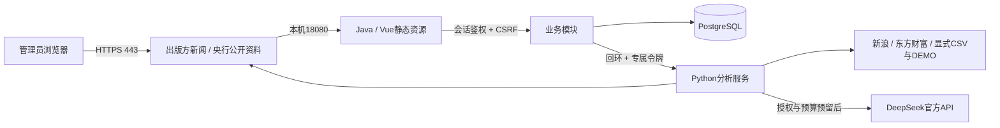

# 技术架构说明

V1.0采用模块化单体：Java17 / Spring Boot3.5负责权限、PostgreSQL持久化、事务、任务、预算和审计；Python3.12 / FastAPI负责行情适配、特征、模型、Decimal撮合及LLM协议；Vue3 / TypeScript / Element Plus / ECharts构建中文管理台，构建结果由Java同源提供。无真实证券账户、委托接口、QMT、GPU、Docker、Kafka或Kubernetes。

Java按`market`、`strategy`、`prediction`、`paper`、`scheduling`和`api`划分职责。`ai-analysis-service`是独立Python包，与量化服务共享一个进程以节约8GiB内存；协议和Schema保持独立，可配置OpenAI兼容提供商，但当前中国内地部署禁用GPT。前端只调用Java，不直接访问数据库、Python或模型Key。

Flyway管理V1至V6迁移：行情/来源/质量、日历与分红、策略与风险版本、模型、新闻、LLM分析与预算、冻结预测及批次输入、实际对账、回测、虚拟账户/持仓/订单/成交/净值、风控、任务、审计及管理员凭据。主键以外只设置必要查询索引；同业务键去重通过事务级advisory lock与行锁实现。预测及预测输入由数据库触发器禁止更新和删除，实际结果单独写表。

单管理员认证优先读取`admin_credential`的BCrypt哈希，无记录时读取受保护部署哈希。改密接口只接受当前会话账号，CSRF与旧密码校验通过后在事务锁内更新，审计不含口令或哈希。Spring SessionRegistry令全部旧会话失效；服务重启后凭据仍从数据库读取。没有注册、多用户或真实证券身份集成。

金额与价格由PostgreSQL NUMERIC和Python Decimal / Java BigDecimal结算。前端及指标统计可使用浮点显示，但不得写回账户结算。数据库和Java默认UTC；业务交易日与展示使用Asia/Shanghai。Windows时区命名通常为China Standard Time，不能直接传给Java ZoneId；业务调度显式指定IANA名称，不依赖系统显示时区。

模型训练固定种子、单CPU线程，保存依赖版本、完整压缩输入、特征版本、数据摘要、各时间分区、超参数、校准器和joblib工件。依赖锁文件、源码提交和输入快照共同支持复现。输入工件只读取受控制目录，不接受外部上传任意joblib或pickle。

XGBoost另存官方JSON模型和独立校准器，用于Linux到Windows部署。原始内存快照保留，但运行时优先加载可移植制品；12个真实模型已在Windows验证。此选择遵循[XGBoost模型保存文档](https://xgboost.readthedocs.io/en/stable/tutorials/saving_model.html)，不能把pickle内存快照视为稳定的跨平台格式。

数据库任务队列串行执行，RUNNING租约过期10分钟后恢复；普通失败最多快速重试3次，日终任务仍失败时每小时重新唤起同一业务键。模拟结算在单事务内提交现金、持仓、订单、成交及快照；前一结算日不完整则停止推进。已关闭策略继续估值，但不产生新订单。

安全边界：Web会话鉴权/CSRF/HttpOnly Cookie；内部令牌；业务端口与数据库仅回环；模型调用默认关闭且默认预算为零；配置受Windows ACL或本机0600保护。启动、暂停、风险修改、失败任务均可审计。平台没有真实证券交易适配器。
