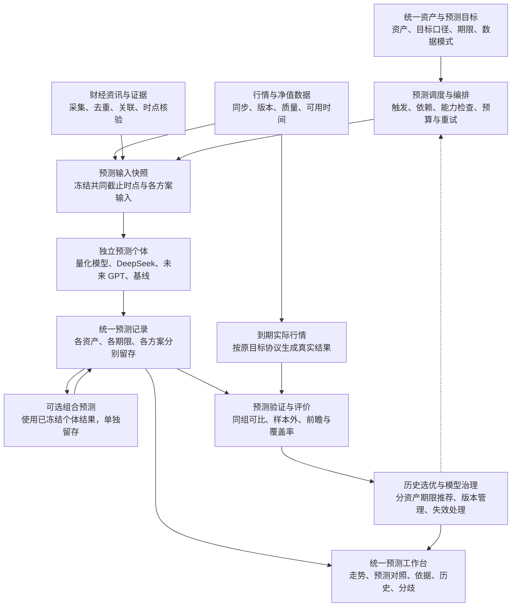
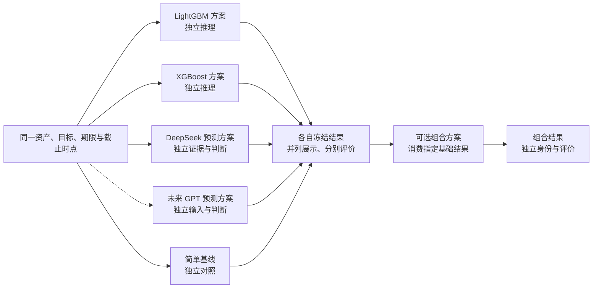
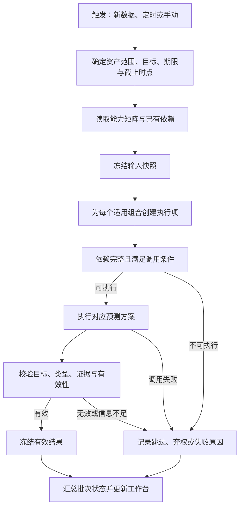
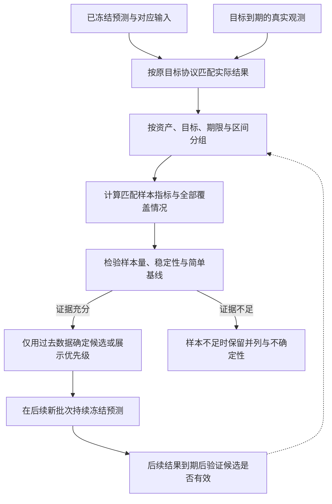
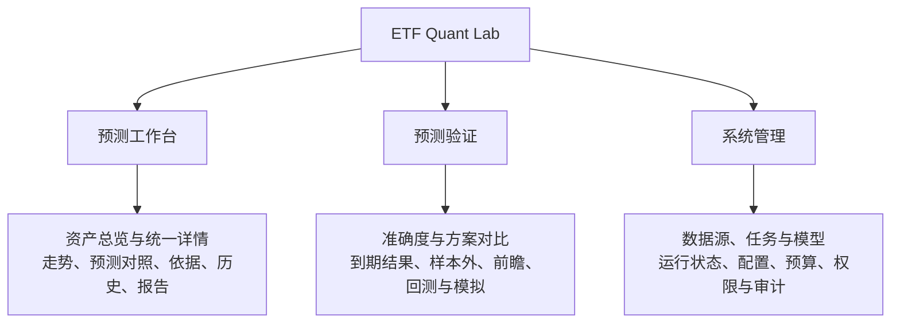

# ETF Quant Lab 行情预测业务架构2.0

> 文档版本：2.0；编写与源码核对日期：2026-10-29（北京时间）。
>
> 本文是**目标业务架构与未来实施依据**，不是已上线功能说明。“2.0”仅为本文版本，不代表应用版本、数据库版本或模型版本。
>
> 用户本轮要求：详细归档上下文，将当前讨论方案保存到桌面，代码在以后合适的时候实现。因此本轮只交付文档与归档，不实施系统改造。
>
> 源码核对基线：`e9a74982764d93118ee9174798ac18ea741e7a0d`；进入本轮文档扩写前为 `ee875c1`，其新增内容仅为上一版架构文档与索引。本文描述的代码事实不等于当前服务器运行状态。

## 1. 核心结论

ETF Quant Lab 的核心业务是：**针对明确的资产和预测目标，让多个预测个体分别给出可追溯的判断，等待真实行情发生后，持续检验各个体在各资产、各期限上的预测效果。**

资讯获取、行情同步、任务调度、DeepSeek 分析、机器学习训练、量化推演、结果展示和历史验证，全部围绕这条业务主线组织。系统不再按“工作空间”和“研究维护”形成两套独立研究体系，也不再把场外基金、场内 ETF、黄金各自做成完整但互不连通的小系统。

统一的是资产入口、预测语义、执行流程、记录关联、展示上下文与评价方法；不同资产的数据来源、日历、计价方式和模型适用范围仍需保留真实差异。**统一业务，不等于强行用一个模型、一张宽表或同一个期限覆盖全部资产。**

用户最终应能直接回答五个问题：

1. 我正在预测什么资产、什么期限、什么价格或收益口径？
2. LightGBM、XGBoost、DeepSeek，以及未来接入的 GPT，各自预测什么？
3. 每个结果依据哪些当时已知的数据、资讯和模型版本？
4. 结果到期后谁更准确，样本是否足够、是否公平可比？
5. 当前展示的优先参考结果为什么被选中，其他结果与分歧在哪里？

## 2. 决策状态与本轮边界

### 2.1 用户已明确的方向

| 事项       | 本轮讨论结论                                                     |
| ---------- | ---------------------------------------------------------------- |
| 系统定位   | 行情预测是核心；资讯、调度、大模型、量化模型围绕预测展开         |
| 模块整合   | 合并工作空间与研究维护的业务割裂，保持菜单和模块统一             |
| 预测个体   | 量化模型、DeepSeek 等分别参与；未来可能加入 ChatGPT/GPT          |
| 多资产预测 | 每个适用个体对每个适用资产分别产出分析预测结果                   |
| 效果判断   | 识别哪个个体对哪个资产、哪个期限更有效，而非只选一个全局最强模型 |
| 本轮交付   | Mermaid 架构图、模块与模型用途、详细上下文归档、桌面 Markdown    |
| 实施时机   | 用户以后在合适时机再实现代码；本轮不开始业务改造                 |

### 2.2 本文提出、实施前需要定版的建议

本文推荐三个一级菜单、统一预测记录语义、显式能力矩阵、分组评价、独立方案和组合方案分开管理，以及渐进迁移。这些是承接用户目标的设计建议，不是用户已经逐项批准的接口、表结构、阈值或施工方案。

首批支持哪些“个体 × 资产 × 期限”、是否马上引入独立 DeepSeek 数值预测、是否开启融合、采用什么选优规则和评价门槛，均应在未来具体实施方案中确定。未来 GPT 的产品、模型、调用方式和费用也未确定。

### 2.3 本轮不做什么

本轮不修改业务代码、数据库结构、任务配置、运行环境或历史预测；不训练模型，不发起付费预测，不新增数据源，不部署、不推送远程 Git，也不接入证券账户或真实资金。现有手工账本与定投功能已在此前阶段下线，本方案不恢复它们；既有回测与模拟实验保留为验证能力。

## 3. 业务术语：先定义同一个问题，再比较答案

| 术语      | 含义                                                     | 示例与边界                                                    |
| --------- | -------------------------------------------------------- | ------------------------------------------------------------- |
| 资产      | 被研究的具体对象，具有稳定身份、品种、计价和来源         | `460300` 与 `510300` 是不同资产；`008701` 与 `Au99.99` 也不同 |
| 预测目标  | 预测对象、起点、终点、价格口径和计算方法的组合           | 未来 20 个净值观察后的净值收益；下一开盘到再下一开盘是否上涨  |
| 期限      | 数值与单位共同定义的观察跨度                             | 20 个基金净值观察，不等于 20 个自然日或已核验交易日           |
| 预测方案  | 一套确定的算法或提示词、特征、目标与输出规则             | 基金 LightGBM 收益点预测方案；DeepSeek 资讯预测方案           |
| 预测个体  | 本文业务称呼，指可独立执行、留存和评价的预测方案及其版本 | LightGBM 与 XGBoost 分开；DeepSeek 不与 GPT 混为“AI”一栏      |
| 模型制品  | 某个方案训练后产生的具体文件或参数版本                   | 同一方案可能为多个资产、多个期限分别训练多个文件              |
| 预测批次  | 一次指定资产范围、目标与信息截止时点的执行集合           | 某交易日收盘后的一批；新资讯触发的另一个批次                  |
| 预测记录  | 某个个体针对某资产、某目标、某期限的一次有效输出         | 有独立 ID、输入引用、版本、生成时间和状态                     |
| 分析依据  | 与某预测绑定的数据、新闻证据、推理摘要和限制             | 旧预测只能回看其当时依据，不能自动替换成最新资讯              |
| 实际结果  | 按预测目标协议、到期后计算的真实观测                     | 到期价格、真实收益或方向；与原预测分开追加                    |
| 评价      | 对预测与实际结果的比较                                   | 点误差、方向准确率、概率评分、区间覆盖等                      |
| 推荐/选优 | 依据过去有效评价，选择当前优先展示的方案                 | 不能用本次尚未发生的结果选择“本次最佳”                        |
| 融合      | 以多个个体的结果为输入生成另一个预测                     | 作为独立组合方案留存，不能覆盖组成它的原始预测                |

必须区分“DeepSeek 供应商名称”“具体模型版本”“提示词版本”和“预测方案版本”。只记录 `DeepSeek` 或 `LightGBM` 无法复核历史结果，也不足以判断升级后效果是否变化。

## 4. 总体业务架构图



图中的反馈表示历史评价影响**后续**批次的候选、展示和训练决策，不允许反过来修改已冻结预测。可选组合只消费指定的基础记录；图中的回写是新增组合记录，不是递归反复融合。

业务上可总结为：**定义问题 → 获取当时可用信息 → 多个个体独立预测 → 冻结结果与依据 → 观察实际行情 → 分组评价 → 改进后续预测。**

## 5. 每个业务模块负责什么

| 模块               | 用来做什么                             | 主要输入                             | 主要输出                               | 责任边界                                                 |
| ------------------ | -------------------------------------- | ------------------------------------ | -------------------------------------- | -------------------------------------------------------- |
| 资产与目标目录     | 统一资产身份、研究目标与可用期限       | 已核验资产资料、目标协议             | 资产目录、目标定义、支持矩阵           | 不把联接基金、ETF、指数、黄金基准自动当同一资产          |
| 行情与净值         | 为预测和实际结果提供可追溯价格观测     | 行情源、净值源、受控导入             | 带来源、版本与可用时间的观测           | 不把演示数据冒充真实数据；不混淆原始价与复权价           |
| 财经资讯与证据     | 获取与资产相关、可核验且当时可得的信息 | 公告、新闻、宏观资料等已接入来源     | 去重证据、相关资产、发布时间与抓取时间 | 不直接把采集成功视为有效预测信号                         |
| 特征与输入快照     | 将数据组织为每个方案明确的输入         | 行情、净值、资讯、资产映射           | 输入快照、特征版本、证据引用           | 不允许晚到信息进入更早批次；不要求各算法使用完全相同特征 |
| 调度与执行         | 决定何时预测、等待哪些依赖、如何重试   | 定时触发、新数据、手动请求、能力配置 | 批次及各组合执行状态                   | 不以任务成功代替预测有效；不因刷新页面自动收费           |
| 量化训练与模型管理 | 训练、验证、登记可用于推理的制品       | 历史样本、标签、划分规则、算法配置   | 模型制品与验证报告                     | 训练与日常预测分开；未训练成功不能静默借用别的资产模型   |
| 预测个体执行       | 各自回答同一个明确目标问题             | 自己的合法输入快照和方案版本         | 类型明确的预测、依据及拒绝预测原因     | 独立方案不得偷看其他方案结果；信息不足可弃权             |
| 预测与依据存储     | 保存可回溯的预测事实                   | 校验后的输出、模型与输入引用         | 不可覆盖的预测记录及历史               | 旧结果保持原意；新批次、新版本追加记录                   |
| 组合预测           | 在需要时评估组合是否提供额外价值       | 指定基础预测、组合版本与过去权重依据 | 单独的组合预测                         | 可选；不能自动把情绪分数变成上涨概率                     |
| 实际结果与评价     | 到期后公平比较预测与事实               | 冻结预测、到期观测、评价规则         | 单条评分、分组统计、覆盖和缺失原因     | 未到期、信息泄漏、不可比样本不能混入准确率               |
| 选优与解释         | 给用户可说明理由的优先参考             | 过去评价、样本量、稳定性和覆盖       | 按资产目标期限的候选与推荐理由         | 样本不足可不推荐；不能承诺未来最准确                     |
| 工作台与报告       | 围绕同一资产展示预测、分歧和依据       | 统一读模型、历史记录与评价           | 资产页、总览、冻结报告                 | 报告引用已有结果，不额外生成另一套隐形预测               |
| 系统管理           | 管理运行依赖和可观测状态               | 任务、来源、模型、预算、配置与权限   | 运行状态、失败原因、人工处置入口       | 运维配置不分散成另一个业务入口体系                       |

这些是逻辑职责，不意味着新增十三个服务。现有 Java 服务层、Python 算法模块、数据库和 Vue 页面可逐步承接，优先复用已有任务队列和领域实现。

## 6. 资产与期限：统一目录，保留真实差异

### 6.1 当前已核对的研究对象

| 类别     | 代码/对象 | 当前源码中的名称或含义         | 当前期限语义                     | 不能混淆的事项                                                          |
| -------- | --------- | ------------------------------ | -------------------------------- | ----------------------------------------------------------------------- |
| 场外基金 | `460300`  | 华泰柏瑞沪深300ETF联接A        | 20/60 个有效净值观察             | 对 `510300` 的参考关系目前标注研究代理，不能据此宣称目标合同已核验      |
| 场外基金 | `007169`  | 易方达中债1–3年国开行债券指数A | 20/60 个有效净值观察             | 债券基金不应机械套用股票情绪；标的指数映射需按真实资料核实              |
| 场外基金 | `008701`  | 华夏黄金ETF联接A               | 20/60 个有效净值观察             | 与黄金基准不是同一价格；目录中的 `518850` 关系不表示该 ETF 已纳入预测池 |
| 场内 ETF | `510300`  | 华泰柏瑞沪深300ETF             | 旧模型有 1/5 日；新前瞻协议为 H1 | 旧标签与新开盘到开盘标签不可因期限数字相同而混评                        |
| 场内 ETF | `510500`  | 南方中证500ETF                 | 同上                             | 与 `510300` 分资产留存和评价                                            |
| 场内 ETF | `159915`  | 易方达创业板ETF                | 同上                             | 不把三只 ETF 的总成绩当某一只的专属效果                                 |
| 黄金基准 | `Au99.99` | 上金所人民币/克价格研究对象    | 63/126 个交易日模型              | 12 个月条件情景不是已校准的 12 个月概率预测                             |

这张表说明当前研究范围，不承诺这七个对象在生产都有最新、完整、有效的模型和预测。资产目录、模型可用性、运行开关与最新数据状态需要在实施或运行时分别核查。

### 6.2 目标协议至少定义什么

每个预测目标至少明确：资产身份、计价单位、基准价格、起点规则、终点规则、期限单位、收益或方向定义、信息截止时点、实际结果取数方法。未来如需分类为上涨/震荡/下跌，还要先定义阈值和零收益归类，不能由各模型自由解释。

例如，现有基金模型用净值序列形成端点收益，不能直接宣传为含分红再投资的完整投资收益；ETF 原始价与复权价也不能互换。不同定义可共存，但必须分组评价。

统一资产页可以显示相关 ETF、基金或黄金基准的辅助走势，但要标明“关联参考资产”。关联资产的收益不能代替目标资产的实际收益，资讯关联也不能仅靠名称相似。

### 6.3 能力矩阵

能力矩阵按“方案 × 资产 × 目标 × 期限”明确是否支持、是否启用、是否具备有效输入/制品。配置支持并不表示某一批次执行必然成功。

| 方案类型     | 当前已有基础                            | 2.0 目标中的位置                         | 实施边界                                       |
| ------------ | --------------------------------------- | ---------------------------------------- | ---------------------------------------------- |
| 基金量化     | LightGBM 收益点预测，20/60 净值观察     | 独立基础预测个体                         | 不自动补出上涨概率、区间或逐日路径             |
| ETF LightGBM | 旧预测及新前瞻中已有实现                | 独立基础预测个体                         | 先锁定采用哪一目标协议                         |
| ETF XGBoost  | 旧预测及新前瞻中已有实现                | 与 LightGBM 分开的个体                   | 不因 ETF 已有 XGBoost 就宣称基金、黄金也已支持 |
| 黄金量化     | 小型固定 LightGBM 方案，63/126 日       | 黄金目标下的独立个体                     | 保留其输入、校准与评估边界                     |
| DeepSeek     | 已有基金、ETF、黄金分析协议，作用不一致 | 未来可建设独立预测方案，也可继续提供解释 | 现有定性分析不能直接冒充同目标数值预测         |
| GPT          | 本轮没有核实到已接入实现                | 用户提出的后续候选个体                   | 尚未选择产品、版本、提示词、预算和目标输出     |
| 简单基线     | 现有部分验证已有基准比较                | 为复杂模型是否提供增益作对照             | 根据目标选择零收益、历史均值等，不能任意套用   |
| 组合方案     | 现有 ETF 有实验融合分数                 | 可选的单独预测个体                       | 现有分数不等于通用、校准后的综合概率           |

## 7. 每个模型/预测个体具体做什么

### 7.1 量化模型

量化模型从历史价格、成交量、技术特征或其他已验证特征学习规律。训练阶段产生制品，推理阶段用最新合法输入生成某资产某期限的预测。两阶段应共享清晰的目标定义，但不需要每次预测都重新训练。

LightGBM 与 XGBoost 是不同算法个体；同一算法换了目标、特征、训练窗口、重要参数或校准方式，可能构成新的方案版本。某个方案为不同资产和期限训练的文件，是该方案的具体制品，不能把“模型文件数量”直接当“个体数量”。

已有基金方案只承诺收益点预测，页面应该诚实显示其能力。没有概率输出就不显示伪造的置信度，没有路径输出就不画成未来每天必然经过的轨迹。若只展示端点连线，应明确它是示意，不是逐日预测。

### 7.2 DeepSeek

DeepSeek 可承担两类业务任务，需要在记录和页面上区分：

1. **证据解释**：解释新闻、公告、政策与资产的影响机制、反证、风险和不确定性。它可以服务工作台的分析依据，但不天然构成可打分的行情预测。
2. **独立预测**：在确定目标、期限、输入与输出协议后，对资产输出方向、概率、点值或区间中的明确能力，并独立留存和评价。

本轮目标中的“DeepSeek 预测个体”指第二类。第一类可继续存在，但必须避免给用户造成“已经和量化模型一样预测了同一问题”的错觉。情绪分数高不表示未来收益率高，也不表示上涨概率高。

独立 DeepSeek 方案可以读取行情摘要和当时合法资讯，但若要与量化个体做独立比较，就不应读取对方本次预测结果。其输出应附证据 ID、重要正反因素、失效条件及信息不足原因；不能要求模型在无有效证据时硬给数字。

### 7.3 未来 GPT / ChatGPT

用户提到的 ChatGPT 在业务图中表达为“未来 GPT 预测方案”。实际实施时，需要明确可被系统调用的产品、模型版本和接口方式，不能把一个聊天产品名称直接视为已经存在的系统连接。

GPT 若使用自己的规定输入独立回答同一目标，可以与 DeepSeek 并列；若读取 DeepSeek 和量化输出后给综合意见，则应登记为“GPT 组合/审议方案”。两种模式都可以研究，但不能混用一个独立个体身份计算成绩。

### 7.4 简单基线

基线用于回答“复杂方案是否比简单做法更有用”。收益点预测可比较零收益或训练期历史均值；方向预测可比较只利用训练期信息得到的简单方向规则。选择哪种基线应按目标预先约定。

基线同样遵守时间边界，不能用完整测试期统计值构造。基线成绩不需要付费大模型调用，也不应被隐藏，以免只在若干表现一般的复杂模型中评出一个表面第一名。

### 7.5 可选融合与审议模型

融合的业务目标是验证“多个个体组合是否提供额外价值”。它不是统一系统的前提，也不是必然优于任何单个模型。

组合记录应指向被消费的基础预测 ID，记录组合公式或提示词版本、权重依据、缺失时的规则和输出类型。缺少一个个体时，可以按预先约定的规则降级，或不生成组合；不能把缺失值当中性零值补齐。



该图表达目标能力，不代表每条分支对所有资产都已实现。独立分支之间没有互相读取预测结果的箭头。

## 8. 预测数量：n × m 的成立条件

固定一个批次、一个目标协议和一个期限，若有 `n` 个启用且适用的预测个体、`m` 个资产，全部组合均成功时，基础预测数量为：

```text
基础预测数 = n × m
```

若每个组合都支持相同的 `h` 个期限，且全部执行成功，则为 `n × m × h`。实际各资产的期限和能力不同，更准确的口径为：

```text
计划组合数 = Σ 每个资产实际配置的「目标 × 期限 × 适用个体」组合数
有效预测数 = 计划组合中通过输入和输出校验、真正冻结成功的结果数
缺失组合数 = 不支持、未启用、数据不足、模型不可用、超时、预算不足等的统计
```

不支持、未启用等配置排除项，与已计划但本批次失败的执行缺口，应分开统计，不能用同一个成功率分母混算。

**数量示例只是算术示例，不代表首批已批准范围：**若三只基金各使用 LightGBM、DeepSeek、GPT 三个独立方案，全部支持 20/60 两个期限，则每批最多 `3 × 3 × 2 = 18` 条基础记录。每个资产期限再生成一个组合方案，则增加 `3 × 2 = 6` 条，共 24 条。若 GPT 尚未接入，不能把其空缺也算成有效预测。

预测记录数不等于训练文件数，也不等于外部 API 请求数。一个 API 请求可能返回多个资产或期限，一个方案可能无需本地训练，一次任务可能复用完全相同输入下已有结果。计费按真实调用记录核算，准确度按有效预测记录与真实结果计算。

如果同一资产同一天因新闻更新产生多个批次，记录可以增加；但日终评价不能让“调用频率高”的个体通过更多重复样本获得额外权重。用于排名的批次选择规则需预先固定，例如每个目标时点采用最后一个合法截止批次，并保留其他批次供分析。

## 9. 数据与资讯如何进入预测

### 9.1 价格观测与可用时间

每条用于预测的观测，应能说明它描述哪一天、来源何处、系统何时取得、当时是否已公开以及是否发生修订。基金净值归属日不等于净值已经可用的时间；历史接口今天返回的修订值，也不能自动声称过去就已经知道。

数据修订不覆盖旧预测的输入。新预测可以使用修订后的观测版本，但必须引用新快照；旧预测继续引用原版本。生成实际结果时，也应记录所采用的结果口径和数据修订版本。

市场真实数据、用户导入数据、演示数据与 Mock 输出分别标识。来源失败、超时或缺日时，应显示真实状态，不得静默切换到 DEMO 使页面看似正常。

### 9.2 资讯证据

资讯处理链包括采集、来源标识、去重、时间校验、资产关联和证据引用。至少区分新闻发布时间、首次获取时间、内容修订时间和本次信息截止时点。对于未能证明当时可得的历史新闻，不纳入严格样本外评价输入。

资产关联需要解释经济关系。例如债券基金应关注利率、期限和相关发行主体等影响渠道；基金经理变更、基金公告和跟踪资产新闻具有不同作用。不能因为一条宏观新闻提到“市场”就给所有资产同样的情绪。

一条新闻可关联多个资产，但各资产的影响机制和权重不必相同。抓取成功、筛选相关、证据合法、分析成功、预测有效，是不同阶段，不能合并成一个绿色成功状态。

### 9.3 公平比较不要求输入完全相同

同组预测必须对同一目标、在明确的共同信息截止时点规则下回答问题，但可以使用各自方案规定的不同特征。量化模型使用价格特征，DeepSeek 使用价格摘要和新闻，属于方案差异，需要记录并披露。

任何个体都不能使用截止之后的信息。执行结束时间可以晚于截止，但应记录延迟，判断是否仍满足预先规定的预测提交时限。如果实际目标区间已经开始甚至结束，不能把事后生成的结果冒充可用的实时前瞻预测。

### 9.4 最新资讯与历史预测依据并存

页面可以同时提供“本次预测依据”和“最新资讯”，但两者必须有明显时间和身份标识。切换到历史预测时，默认依据面板切换到该记录绑定的证据；最新资讯只作为独立参考，不能悄悄替换旧判断的证据链。

## 10. 调度：一次预测任务应该如何完成

### 10.1 合理触发

| 触发               | 应驱动的行为                                     | 不应隐含的行为                           |
| ------------------ | ------------------------------------------------ | ---------------------------------------- |
| 新行情/净值可用    | 检查相关资产的输入更新，安排适用预测和到期评价   | 不要求所有模型每次重新训练               |
| 新相关资讯可用     | 更新证据；为使用该信息的方案安排新批次或更新分析 | 不声称只看价格的量化模型必然发生数值变化 |
| 约定日终/周度时间  | 在日历和依赖满足后组织一批预测                   | 不是到点就允许缺行情也出有效结果         |
| 用户手动请求       | 在当前权限、预算和能力范围内执行                 | 普通打开或刷新页面不自动产生付费请求     |
| 新模型版本准备就绪 | 对后续批次使用或受控比较新版本                   | 不覆盖旧版本已经生成的历史记录           |
| 预测目标到期       | 生成实际结果和评价                               | 不需要重新调用模型改写原判断             |



### 10.2 复用、重试与失败隔离

同一方案版本、资产、目标、期限、输入快照和运行规则完全相同，重试应复用已成功结果或继续未完成步骤，避免重复收费和重复记录。输入或方案变化时产生新预测身份。实际键结构在实施时基于现有记录设计，不在本文预定一套新数据库索引。

单个个体失败不应抹去其他已成功个体的结果。批次可显示部分完成，并逐项说明缺口。只有定义为同一组合必需的输入缺失时，才阻断该组合。预算不足、数据不足、输出格式错误与模型主动弃权应分开呈现。

对大模型调用沿用明确预算、费用记录与失败原因。已有服务中的预算数字是各阶段配置事实，不意味着新方案可以提高预算、自动开放 GPT 或不经授权增加外部调用。

### 10.3 复用现有执行设施

当前 `TaskService` 已有 PostgreSQL 持久任务、租约和重试机制，多个业务类型已共用队列。未来优先在现有机制中整理依赖与任务职责，不为画图完整而新增消息中间件、独立调度服务、通用工作流平台或多代理框架。

菜单统一与执行串并行是不同问题。先保证预测身份、输入和依赖正确，是否并行执行再根据真实资源瓶颈决定；不能把逻辑图中并列的个体误解为必须同时占满机器运行。

## 11. 训练与推理的生命周期

量化方案应经历：明确目标与特征 → 时间顺序切分样本 → 训练 → 独立验证/必要校准 → 留出样本评估 → 登记制品和能力 → 后续批次推理 → 实际到期评价。

标签跨越时间分割边界的训练样本必须清除，避免训练标签偷看到验证或测试期。20/60 等长期窗口会产生重叠标签，不能把每日重叠样本都视为独立观察。评估报告应保留原始样本数和非重叠或近似有效样本量说明。

训练成功只证明训练过程产出了制品，不证明适合默认使用；HTTP 成功只证明调用返回，不证明输出满足协议；历史回测好看也不能代替未来冻结样本的验证。

大模型通常没有本地训练制品，但仍需管理供应模型标识、提示词、证据处理规则、输出协议和推理配置。提示词升级后应可辨认新旧结果；如果远端模型无法完全锁定，记录实际返回标识与时间，并披露复现限制。

版本治理不必第一步就建设复杂“模型平台”。最小要求是记录能复现与解释结果的版本信息、区分候选与已启用方案、能够停止使用失效方案，并保留历史记录。

## 12. 统一预测结果：共同身份，按能力输出

### 12.1 共同身份和关联信息

下表为逻辑合同建议，说明必须表达的业务含义，不是本轮已经定版的物理字段、表名或接口 Schema。

| 信息组   | 需要表达的内容                                       | 作用                                   |
| -------- | ---------------------------------------------------- | -------------------------------------- |
| 记录身份 | 预测 ID、所属批次、资产、目标协议、期限值与单位      | 找到唯一的问题和答案                   |
| 时间身份 | 信息截止、锚点、生成时间、目标到期规则与可确定的日期 | 判定有没有未来信息、是否到期、是否过时 |
| 个体身份 | 方案、版本、算法/供应模型、具体制品或提示词版本      | 允许同类算法升级后的分版本评价         |
| 输入身份 | 行情/净值快照、特征版本、证据集合、数据模式          | 从结果回溯到当时已知内容               |
| 输出能力 | 方向、概率、点预测、区间等类型以及各自语义           | 避免把不同含义数字塞进同一个“预测值”   |
| 解释信息 | 主要依据、反向证据、假设、限制和失效条件             | 理解模型分歧和适用范围                 |
| 运行信息 | 成功、弃权、失败等状态，耗时和关联费用记录           | 评价准确度时同时考虑可用性与成本       |
| 组合关系 | 若为组合，记录引用的基础预测及组合版本               | 识别依赖、避免冒充独立个体             |

### 12.2 结果类型不能互相冒充

| 结果类型      | 语义                                   | 可以怎样评价                 | 不能怎样使用                     |
| ------------- | -------------------------------------- | ---------------------------- | -------------------------------- |
| 方向          | 对定义好的上涨/下跌/震荡目标的类别判断 | 方向准确率、分类混淆情况     | 不自动解释成 80% 等概率          |
| 上涨概率      | 明确事件在期限内发生的概率估计         | Brier 等概率评分、校准分析   | 不把主观自信或情绪强度直接当概率 |
| 收益/价格点值 | 明确单位和目标下的单个估计值           | MAE 等点误差                 | 不等于保证收益或确定路径         |
| 预测区间      | 明确覆盖含义和上下界的区间             | 实际覆盖率与区间宽度         | 只报覆盖率、忽略极宽区间会误导   |
| 定性解释      | 机制、证据、风险与不确定性             | 证据可追溯、协议与事实一致性 | 不计作同目标的数值预测胜负       |
| 条件情景      | 在某假设成立时推演可能变化             | 检查条件及后续事实，独立呈现 | 不把情景权重或假设当已校准概率   |

若只有点预测，可以按照预先约定规则派生方向，但要标记为派生能力。若没有上涨概率，则该个体不参与上涨概率评分。允许不同能力并列展示，拒绝为统一页面而虚构字段。

### 12.3 预测、实际结果、评价、推荐分开

原预测回答“当时判断是什么”；实际结果回答“后来发生什么”；评价回答“判断表现如何”；推荐回答“基于过去证据现在优先看谁”。四者发生时间和语义不同，应通过引用关联，不可互相覆盖。

数据修订可能需要新的实际结果或评价版本，但不改写原预测。历史推荐也应能说明当时用了哪个评价区间与规则，避免今天的排名被误认为当时已经知道。

## 13. 到期评价：如何知道谁对某资产更准确

### 13.1 先分组，再比较

最小可比组应至少具有相同的：

```text
资产 × 预测目标协议 × 期限及单位 × 评价区间 × 数据模式/质量口径
```

按固定批次选择与提交时限规则确定可比预测，并区分历史训练内、样本外回测、真实前瞻、模拟交易。20 个净值观察与 20 个自然日不是一组；旧 ETF 1 日标签与新开盘到开盘标签不是一组；同一资产也可能存在多个不可混用的目标。

### 13.2 指标与用户问题对应

| 用户想知道什么           | 应看指标/证据                  | 必须同时看                           |
| ------------------------ | ------------------------------ | ------------------------------------ |
| 涨跌判断是否靠谱         | 方向准确率、分类分布与混淆情况 | 多数类别基线、样本量、类别不平衡     |
| 预测数值离实际多远       | 收益或价格 MAE 等              | 单位、目标、与简单基线的误差对比     |
| 说 70% 上涨是否可信      | Brier 等概率评分、校准分组     | 概率样本量、类别覆盖，未经校准需标明 |
| 预测区间有用吗           | 到期覆盖率、平均宽度           | 名义覆盖与实际覆盖差异               |
| 实际用起来稳定吗         | 分时间窗口表现、失效/漂移情况  | 缺失、过时、晚到、成本与延迟         |
| 会不会只挑容易的时候回答 | 有效输出率、弃权率、失败率     | 相同可比日期上的表现及总覆盖范围     |

准确度与收益不是同一个概念。模拟收益还受仓位、执行价格、成本、规则和风险约束影响，不能把“某策略账户赚钱”直接解释为“某模型预测最准确”。

### 13.3 公平样本与覆盖率

比较两个模型时，应先看同一评价组内双方都合法、按时、已到期的匹配样本，再分别展示各自全部有效样本与覆盖率。否则，一个模型只回答少数简单日期，另一个每天回答，直接比较各自命中率会误导。

弃权、超时、预算不足不应当作一次价格方向预测直接计对错，但必须进入运行与覆盖统计。不能通过少输出隐藏失败，也不能把失败自动写成中性预测。

长周期预测的重叠问题、数据修订、后补记录与模型版本变化，应在评价报告里可追溯。历史新闻没有当时可用证据的记录不能被放进严格样本外胜率来证明效果。

### 13.4 模型选优与验证必须分开



不能用同一段数据选出赢家，再用同一段数据宣称赢家已经被验证。训练、校准、选择、最终验证分别遵循时间顺序；在多次试验和多个候选中选择，还要披露选择过程，避免只保留漂亮结果。

具体最少样本数、评价窗口、指标优先级和更新频率待实施前确定。本文不凭空给出“命中率超过某值就自动推荐”的阈值。

## 14. 最终该展示谁：选优、并列与融合

推荐结果应落在资产、目标和期限上。例如可以出现“资产 A 的短期限优先看 LightGBM，资产 B 的长期限暂时没有充分证据选出赢家”。这完全符合目标，不需要强行给整个平台选唯一冠军。

工作台默认可展示一个“当前优先参考”的结果，同时说明所依据的历史区间、样本量、相对基线表现和更新时间。其他独立个体必须可直接比较，不应因不是默认项就隐藏其分歧或历史。

**选择一个个体作为默认展示，不等于生成了一个新的融合预测。**如果只是引用已有结果，没有新增预测数量；若按公式或大模型重新组合产生新结果，才是独立组合方案，需要新增记录和单独评价。

融合至少有三项约束：输出目标一致、输入类型可合法组合、权重或组合规则只来自当时可得的证据。不能直接把收益率、情绪分数和上涨概率相加后叫“综合概率”。组合校准、缺失降级、相关性与稳定性验证都属于开启融合前的具体设计。

本方案推荐先让独立预测与公平评价成立，再根据实际证据决定是否加入融合。系统的统一不依赖融合上线。

## 15. 统一后的菜单结构

推荐三个一级菜单，让用户沿“看预测 → 验效果 → 管运行”完成任务。它们是目标信息架构，最终菜单名称和页面交互在实施前定版。



### 15.1 预测工作台

资产类型作为筛选项或资产目录中的分组，不再独立创造另一套导航。选中资产后，共享资产、期限、目标、数据模式和预测批次上下文。

资产详情建议包括走势、预测对照、分析依据、预测历史和报告。点开某个预测，所有依据和评价均跟随该记录。黄金成本计算与条件情景可作为黄金资产下的专属工具，保留含义，不上升为另一套全局研究模块。

总览围绕资产最新预测、分歧、到期验证进展和数据状态；不以旧模拟账户资产、现金或盈亏作为整个系统首页的核心。

### 15.2 预测验证

集中展示预测实际结果、按资产期限的模型对比、样本外与真实前瞻情况。既有策略回测、模拟交易作为深入验证工具，标明其执行协议与账户规则，避免与预测准确度混在一个总分里。

旧 ETF 实验、基金验证和黄金验证可逐步通过统一查询入口接入；统一入口不代表历史数据已经满足同一目标协议，不可把旧记录直接改名后合并排名。

### 15.3 系统管理

集中管理数据源与采集质量、任务与失败重试、量化制品和大模型配置、预算与调用记录、权限和运行状态。业务页面可以显示简洁状态和跳转入口，复杂维护操作只保留一个主入口。

### 15.4 现有十三个入口如何合并

| 现有入口   | 当前主要用途                 | 推荐归属                               | 合并时必须处理                           |
| ---------- | ---------------------------- | -------------------------------------- | ---------------------------------------- |
| 走势与预测 | 三基金净值与量化预测         | 预测工作台 → 资产详情                  | 消除三基金专属上下文与 ETF 入口割裂      |
| 分析依据   | 基金预测关联解释、最新资讯   | 预测工作台 → 同一详情的依据            | 保持与选定预测 ID、资产、期限一致        |
| 黄金研究   | 展望、情景、成本、验证、来源 | 预测工作台黄金资产；验证与来源分别归口 | 保留黄金特有语义，不复制整个模块         |
| 系统管理   | 资源、任务、模型、预算与权限 | 统一系统管理                           | 汇集其他页面散落维护能力                 |
| 研究总览   | 旧 ETF 账户、持仓与概况      | 预测工作台总览；账户内容入验证         | 首页主指标改为预测和评价，不能只改标题   |
| ETF行情    | ETF走势、指标、质量与同步    | 预测工作台资产行情；源管理入系统       | 资产选择和数据模式与预测同步             |
| AI预测     | 旧预测、分析、新闻、模型信息 | 预测工作台预测对照与依据               | 从“AI”泛称转为具体个体与目标协议         |
| 策略回测   | 历史策略实验                 | 预测验证 → 高级验证                    | 区分交易收益和预测误差                   |
| 模拟交易   | 虚拟账户和成交               | 预测验证 → 模拟实验                    | 不恢复真实记账/定投，不引入真实资金      |
| 模型比较   | 旧预测/回测/模拟成绩         | 预测验证 → 方案比较                    | 补齐覆盖范围，不能假定已有排名涵盖所有域 |
| 研究日报   | 冻结的旧 ETF 报告            | 预测工作台报告/历史快照                | 引用统一记录，旧报告保留原范围与日期     |
| 前瞻实验   | 新协议决策、对照和运行健康   | 预测验证 → 前瞻；健康入系统            | 保留开盘到开盘协议，不能混入旧 H1 排名   |
| 财经情报   | 新闻、DS 分析、来源与预算    | 预测工作台依据；来源预算入系统         | 业务证据与来源维护共用数据，各有唯一职责 |

合并的验收标准不是侧边栏少了几个按钮，而是用户切换资产、期限与预测后，走势、个体结果、依据和评价始终指向同一业务对象。

## 16. 资产详情页应怎样组织信息

页首固定展示资产身份、目标口径、期限单位、数据模式、信息截止与预测生成时间。数据日期、预测时间和新闻时间不能用一个“更新时间”含混代替。

中部用并列结果展示各预测个体及其状态。每行或卡片包括方案版本、输出类型、当前判断、数据时点和是否可评价；不支持、尚未接入、信息不足、调用失败应有不同说明。比较时保留单位，不把缺失显示为 0。

用户展开某行后，看到该个体自身的输入摘要、证据、模型信息与限制。组合方案还可展开所用基础结果。下方展示相同目标的历史表现、匹配样本数、覆盖率和与基线的比较。

对未来某段区间的图表，应清楚区分历史实际走势、预测端点、真正支持的预测区间、条件情景以及后续已发生的实际结果。不得把说明性连线画成模型实际产出的逐日路径。

当尚无成熟样本、数据不新鲜或候选差异不足时，允许直接显示“尚不能判断哪个方案更可靠”。这比强制挑一个第一名更符合预测研究用途。

## 17. 当前系统已经具备什么、缺什么

以下为本轮本地源码核对结论；没有在本轮重新访问生产。现有代码是可复用基础，但尚未形成本文完整目标流程。

| 领域         | 已有基础                                                                    | 对 2.0 的主要差距                                         |
| ------------ | --------------------------------------------------------------------------- | --------------------------------------------------------- |
| 基础运行     | Java 后端、Vue 前端、PostgreSQL、一个承载量化与 AI 包的 Python FastAPI 进程 | 不需要另建一套系统来实现业务统一                          |
| 导航         | 主区四入口，旧研究区九入口                                                  | 信息架构仍以历史模块划分                                  |
| 资产上下文   | 基金两个页面共享部分上下文；ETF、黄金另有选择和路径                         | 没有跨类型统一的资产/目标/预测上下文                      |
| 基金量化     | 三基金 20/60 净值观察预测、输入冻结、模型与评价记录                         | 仅有该域目标；不能直接映射成所有模型的共同结果            |
| 基金新闻     | 新证据驱动 DS，绑定解释快照                                                 | 数值预测仍为 MODEL_ONLY；新闻作用为 DISPLAY_ONLY/NOT_USED |
| 基金期限匹配 | 新闻协议允许一定期限参数                                                    | 当前正常 Java 调用固定 20，不能说 60 已有对应独立新闻预测 |
| ETF          | 旧预测与新版前瞻各有数据及算法                                              | 两者目标和表不同，不能拿旧排名当新前瞻的全量评价          |
| ETF融合      | 新前瞻中有 ML 与情绪的实验分数及风控规则                                    | 组合分数不是校准概率，且更接近决策/仓位实验               |
| 黄金         | 自有数据、63/126 模型、冻结结果、定性解释和工具                             | 尚未通过统一多模型入口评价；解释不改变数值预测            |
| 任务         | 持久队列统一承载 FUND、GOLD、FORWARD、旧 ETF 等类型                         | 各域调度仍各自组织，缺少目标层的统一批次关系              |
| 排名         | 旧预测、回测与模拟的若干比较视图                                            | 现有查询不等于覆盖基金、黄金、新前瞻的全域排名            |
| 报告         | 旧 ETF 日报已冻结部分研究和账户信息                                         | 尚非跨资产、多预测个体的统一报告                          |
| 未来 GPT     | 用户提出扩展方向                                                            | 本轮未发现对应已实施预测能力                              |

## 18. 当前关键链路的精确差异

### 18.1 基金：新闻更新与数值预测目前未合为一条链

`FundScheduler` 每分钟检查调度条件，资讯按配置周期检查；当前默认 15 分钟是工程轮询间隔，不是新闻发布规律。采集后满足条件可以派生 `FUND_NEWS`。净值同步、训练、预测与评价则在既有时间窗口组织。

`FundResearchService.predict` 的数值请求传入基金、观测和模型，没有把新闻作为量化输入。预测复用依据包含基金、模型与数据快照；新新闻本身不会使同一数值输入自动变成一条新量化预测。记录写入 `MODEL_ONLY`，新闻标注 `DISPLAY_ONLY` 或 `NOT_USED`。

`newsForForecast` 按基金、期限、截止和时效匹配证据；但当前 `prepareNews` 与 `FundNews` 正常调用固定期限为 20。故不能说 60 期限已完成与之同等的 DS 预测闭环。

目标不是为了统一就强迫新闻改变量化数值，而是让纯量化与独立资讯预测各有身份；若未来有“量化加新闻特征”模型，则登记为不同方案，另行验证增益。

### 18.2 ETF：旧预测与新前瞻不能混称一个协议

`DailyScheduler` 在启用新前瞻时转入 `FORWARD_EOD`，并非旧日终和新前瞻同时按原路径执行。`ForwardService` 有自己的行情准备、模型检查、分析、冻结决策、到期评价与模拟账户流程。

`ForwardRules` 当前协议包括 `OPEN_NET_REBALANCE_V1`、`OPEN_TO_OPEN_H1_V1` 和 `NEXT_OPEN_TO_FOLLOWING_OPEN_PRICE_UP`。它关注下一开盘到再下一开盘的事件；不能只因为 H1 就与旧一天模型等同。

现有融合实验以 ML 概率和新闻情绪形成分数，并用于权重与风控。其形式中包含 `0.7 × (2P − 1) + 0.3 × S`，这只是现有实验逻辑，不是本文为通用融合选定的公式，更不等于一个经过校准的上涨概率。

`ResearchViewService` 的旧排名查询和 `ForwardView` 的新前瞻查询分开，基金与黄金也各自管理结果。统一评价需要明确转换语义与查询范围，不能只给旧页面改名字。

### 18.3 黄金：预测、解释、情景与成本分别有语义

黄金量化独立生成 63/126 日结果；现有大模型协议只解释因素，不直接输出可替代量化结果的概率或目标价。调度先预测后解释，页面的最新解释也不天然等于历史预测的冻结输入。

黄金 12 个月情景是条件推演，实物成本计算是工具；它们可以保留在统一资产详情内，但不能计入相同目标下的独立数值预测胜率。

## 19. 推荐技术落点：沿用现有工程，先统一业务合同

本项目已有可承载目标业务的基础：Vue 负责统一交互，Java 负责资产、任务、记录、预算和查询，Python 负责数值算法及 AI 分析，PostgreSQL 保存业务事实。

当前 `quant-engine/src/etf_quant/api.py` 同时导入 `etf_ai` 能力；`ai-analysis-service` 是代码包边界，不应画成已独立部署的第二个 Python 进程。未来业务统一不要求拆微服务。

优先顺序应是：明确目标协议与共同身份 → 建立受限的统一查询和展示 → 让新预测按共同语义留存 → 接入评价。底层历史表可先保留，由清晰的查询映射承接；是否后续迁移表结构，依据真实重复与维护成本决定。

不能为未来可能扩展，先引入通用插件框架、复杂注册中心、多代理编排或大规模数据迁移。新增字段与接口必须服务已批准的第一阶段能力；历史表只做明确需要的兼容处理，不猜测补填不存在的目标或证据。

## 20. 未来最小实施阶段建议

下面是用于以后讨论的顺序建议，**不是本轮执行授权，也不是已批准工期**。每个阶段开始前应核对当时代码和数据状态，再制定最小范围。

| 阶段                  | 核心成果                                     | 为什么先做                       | 验收重点                                     |
| --------------------- | -------------------------------------------- | -------------------------------- | -------------------------------------------- |
| 0：范围定版           | 确定首批资产、目标、期限、个体与能力矩阵     | 避免一开始把所有历史协议强行等同 | 每个组合能明确支持与否、输出和评价方法       |
| 1：统一入口与上下文   | 三大菜单、统一资产详情、预测与依据关联       | 先解决用户直接感知的割裂         | 切资产/期限/历史记录时，各区域身份一致       |
| 2：统一预测身份与执行 | 适用个体独立留存，任务可追踪，重复输入可复用 | 让 n×m 的结果真正成为可核验事实  | 同一组合有明确结果/缺失原因，无覆盖或伪造    |
| 3：独立 DS 预测能力   | 对批准的目标建立可评价输出；保留解释角色     | 现有 DS 并非所有域的独立数值预测 | 独立输入、有效证据、同目标输出、费用可追溯   |
| 4：统一到期评价与选优 | 分资产目标期限的匹配统计与候选说明           | 没有公平评价就不能回答谁更准     | 未到期不评分，样本不足不强选，选择与验证分离 |
| 后续按需：GPT/融合    | 作为新方案按同一合同接入                     | 由实际需求与证据决定收益         | 不破坏基础结果，单独评价成本和增益           |

阶段 2 与阶段 3 的具体切分可以在首批范围明确后调整，但不能把“菜单合并完成”宣称为“预测业务闭环已经完成”。也不能为了等全部未来模型而推迟必要的当前整合。

## 21. 未来验收场景

| 场景                             | 预期行为                                                         |
| -------------------------------- | ---------------------------------------------------------------- |
| 在同一工作台选择基金、ETF 或黄金 | 使用同一导航结构；目标、单位和能力随资产正确变化                 |
| 选择某资产某期限的一个批次       | 能看到各适用个体各自结果及缺失原因                               |
| 从最新预测切到历史预测           | 数据快照、证据、模型版本与评价同步切换                           |
| 相同信息再次触发同一方案         | 复用成功结果或继续未完成步骤，不重复收费和冻结                   |
| 新闻变了但价格没变               | 依赖资讯的方案可形成新输入；纯价格方案可按规则复用，状态诚实展示 |
| DeepSeek 调用失败或信息不足      | 其他个体结果仍保留；失败/弃权不被写成中性有效预测                |
| GPT 尚未接入或不支持该期限       | 标为未接入/不支持，不生成假的占位预测                            |
| 模型结果已经过时或晚于提交期限   | 说明时效问题，不混入有效实时前瞻表现                             |
| 预测尚未到期                     | 展示等待状态，不计算命中或用局部走势判最终对错                   |
| 两个模型覆盖日期不同             | 同时给匹配样本比较和各自覆盖情况                                 |
| 样本量太小或未优于基线           | 不宣称稳定最优，允许暂无推荐                                     |
| 加入组合方案                     | 原始结果不变，组合引用具体基础记录，单独评分                     |
| 数据后来修订                     | 历史预测输入保持原样；新结果/评价修订有版本和原因                |
| 打开旧实验或旧日报               | 保留原目标、范围、日期和数据模式，不伪装成新协议                 |

实施验证应围绕上述业务行为选择必要测试。只改文档不运行业务构建；真正改代码时再按项目规范执行格式化、编译及有意义的相关测试。

## 22. 实施前尚需确定的事项

1. 首批到底覆盖哪些资产、目标和期限；是否先用已有基金/ETF 目标完成闭环，黄金何时接入。
2. DeepSeek 独立预测先输出方向、点值、概率还是其中的子集；证据不足时的最小合法输出是什么。
3. 旧 ETF 与新前瞻协议分别如何展示，哪些历史数据可纳入新入口，哪些只能保留为历史。
4. 是否有必要训练同资产上的第二个量化方案；不能仅为凑齐矩阵扩大首期训练。
5. 比较样本的日期规则、最少样本、滚动窗口、主指标和候选更新频率。
6. 大模型允许的输入、共享预算、调用触发和延迟门槛；新增服务需明确授权范围。
7. “优先参考”只是默认展示还是自动决定后续任务；推荐更新是否需要人工确认。
8. GPT 接入的产品与具体模型；是否独立预测或组合审议。融合是否确有必要，使用什么有证据的规则。

这些待定事项不阻碍保存本方案，也不授权自动采用某个阈值或增加工程范围。

## 23. 关键源码定位

以下路径均相对于 `/home/developer/projects/etf-quant-lab`。通过本节可从业务结论回查当前实现；行号会随未来修改变化，因此以文件和方法职责定位。

| 路径                                                                                                                       | 本轮关注的事实                                       |
| -------------------------------------------------------------------------------------------------------------------------- | ---------------------------------------------------- |
| `frontend/src/App.vue`、`frontend/src/main.ts`                                                                             | 主区/旧区菜单与独立路由                              |
| `frontend/src/pages/FundWorkspace.vue`                                                                                     | 三基金选择、20/60 期限、两个基金子页共享上下文       |
| `frontend/src/funds/FundTrends.vue`、`frontend/src/funds/FundEvidence.vue`                                                 | 走势、任务、预测 ID 与依据切换                       |
| `frontend/src/pages/Market.vue`、`frontend/src/pages/Predictions.vue`                                                      | 旧 ETF 行情与预测各自的数据入口                      |
| `frontend/src/pages/Intelligence.vue`、`frontend/src/pages/Reports.vue`                                                    | 新闻、来源、DS 分析及冻结报告                        |
| `frontend/src/pages/Dashboard.vue`、`frontend/src/pages/Rankings.vue`                                                      | 旧账户总览、既有模型比较视图                         |
| `frontend/src/pages/Forward.vue`、`frontend/src/pages/Gold.vue`、`frontend/src/pages/System.vue`                           | 前瞻、黄金五标签、系统维护职责                       |
| `database/migrations/V2__verified_instruments.sql`                                                                         | 三 ETF 目录                                          |
| `database/migrations/V15__fund_research.sql`                                                                               | 三基金身份、参考资产映射、基金领域记录               |
| `backend/src/main/java/cn/etfquantlab/fund/FundResearchService.java`                                                       | 数值输入、冻结、新闻匹配、MODEL_ONLY 与 DISPLAY_ONLY |
| `backend/src/main/java/cn/etfquantlab/fund/FundNews.java`                                                                  | 基金 DS 输入、期限与输出使用边界                     |
| `backend/src/main/java/cn/etfquantlab/fund/FundScheduler.java`                                                             | 新闻检查与净值/训练/预测/评价调度                    |
| `backend/src/main/java/cn/etfquantlab/scheduling/TaskService.java`                                                         | 共用任务队列、类型分派、重试与新闻后续               |
| `backend/src/main/java/cn/etfquantlab/scheduling/DailyScheduler.java`、`DailyService.java`                                 | 旧 ETF 与前瞻日终分支、旧报告流程                    |
| `backend/src/main/java/cn/etfquantlab/forward/ForwardRules.java`、`ForwardService.java`、`ForwardView.java`                | 新目标协议、实验分数、冻结决策与查询                 |
| `backend/src/main/java/cn/etfquantlab/research/ResearchViewService.java`、`ResearchReportService.java`                     | 旧排名覆盖范围与日报组成                             |
| `backend/src/main/java/cn/etfquantlab/gold/GoldService.java`、`GoldScheduler.java`、`GoldView.java`、`GoldController.java` | 黄金数值预测、解释时序、查询与专属工具               |
| `quant-engine/src/etf_quant/fund_models.py`、`gold_models.py`                                                              | 基金/黄金标签、时间切分、算法与能力                  |
| `quant-engine/src/etf_quant/api.py`                                                                                        | 同一 Python API 进程挂接量化与 etf_ai                |
| `ai-analysis-service/src/etf_ai/fund.py`、`gold.py`                                                                        | 基金证据/情绪与黄金定性解释输出协议                  |

## 24. 文档、上下文与未来接续

本文件完整表达当前目标方案，可独立阅读。桌面交付路径：`C:\Users\developer\Desktop\ETF Quant Lab 行情预测业务架构2.0.md`；仓库源文件：`/home/developer/projects/etf-quant-lab/docs/行情预测业务架构2.0.md`。

详细讨论演进、已排除方向、代码核对事实、前版交付与恢复边界，另见 `/home/developer/projects/etf-quant-lab/docs/项目档案/13-预测业务架构2.0讨论与实施接续.md`。长期入口为 `LOCAL_PRIVATE_ARCHIVE`。稳定资料包入口为 `LOCAL_PRIVATE_ARCHIVE`。

同一讨论沿用 Workflow `20261029_etf_research_unification`；最新进度与授权以中央数据库为准，不以本文或归档快照替代。未来继续时先读取本文和第 13 章，核对当前源码、工作区和任务状态，再根据用户当次实施范围制定方案。此前文档交付完成不代表系统整合已完成，也不继承未来生产、数据库或付费授权。

本文中的 Mermaid 采用标准 `flowchart` 语法，读者可在支持 Mermaid 的 Markdown 阅读器中查看图形；普通文本编辑器会显示源代码。交付校验包含图结构、引用和副本一致性，视觉渲染验收情况以资料包验证记录为准。
